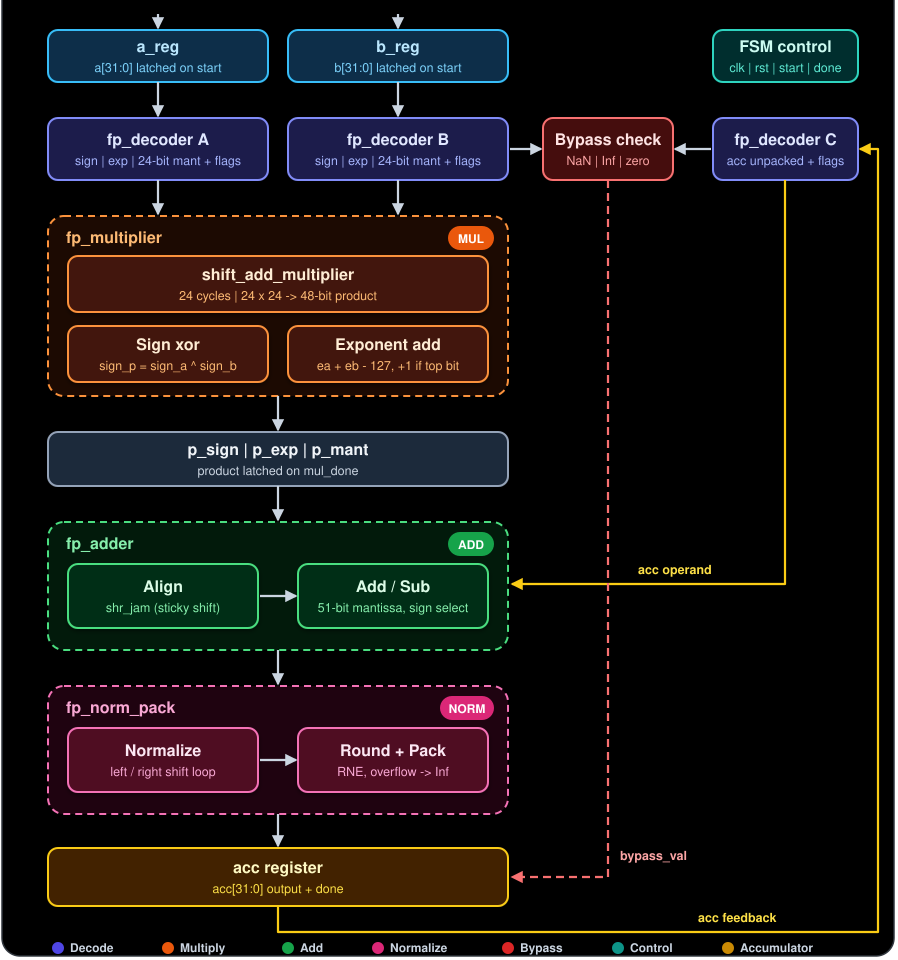
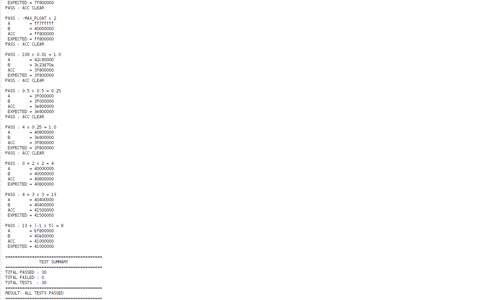
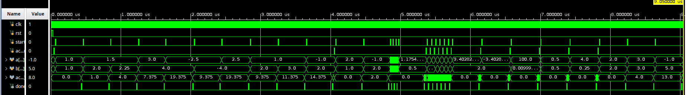
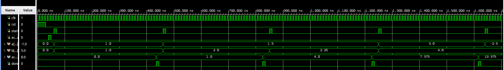
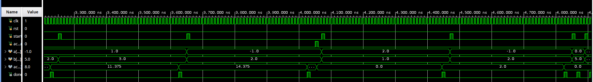
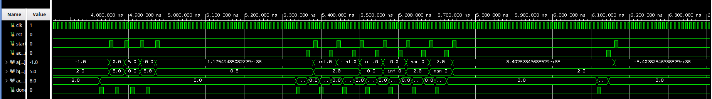
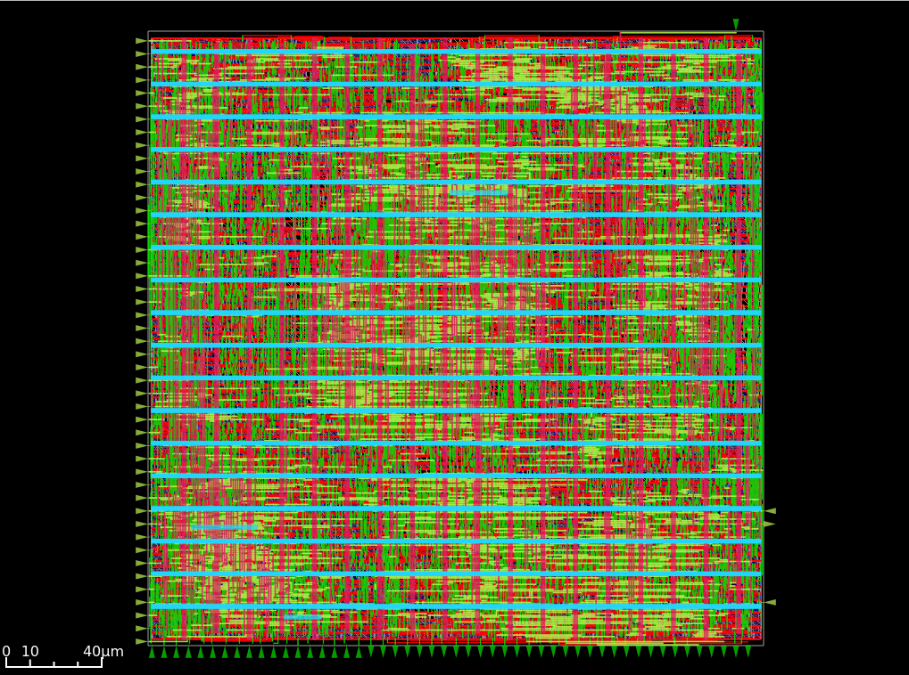
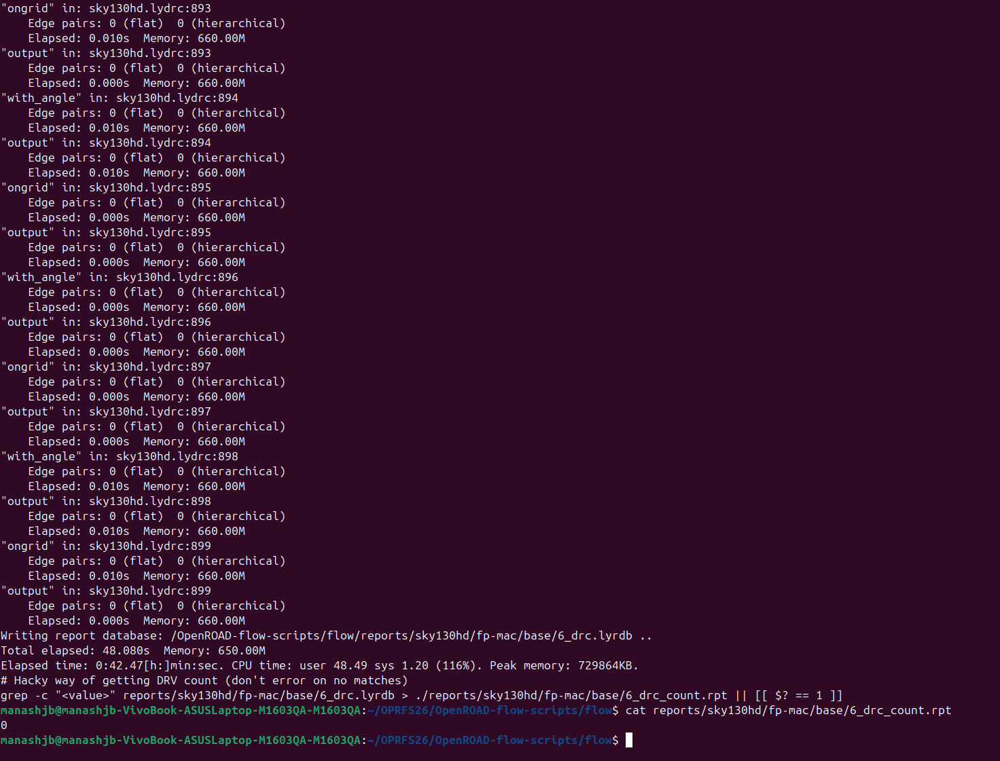
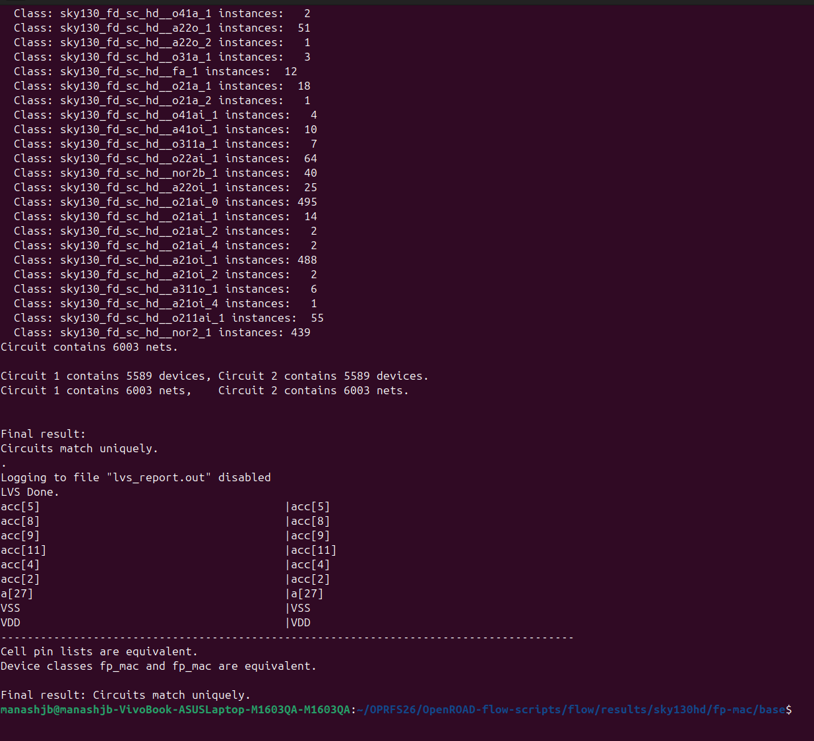

# FP32 Floating-Point Multiply-Accumulate (FP-MAC)

A modular, sequential floating-point multiply-accumulate unit designed in Verilog HDL, implementing a datapath for single-precision IEEE 754 arithmetic.

The design computes:

$$
acc_{\mathrm{new}} = \mathrm{RN}(acc + a \times b)
$$

where RN denotes round-to-nearest, ties-to-even.

Rather than treating multiplication and addition as black-box operators, I built the datapath using separate arithmetic modules, including an iterative shift-add multiplier, exponent alignment logic, extended-precision addition, and a normalization and rounding stage.

The project focuses on floating-point arithmetic at the RTL level, with an emphasis on datapath organization, control sequencing, numerical corner cases, and physical implementation.

## Architecture



The design is organized into five main stages.

### 1. Operand Decoding

**Module:** `fp_decoder.v`

Each 32-bit operand is decoded into its sign, internal exponent, and significand. The decoder also identifies special values such as zero, infinity, and NaN.

Subnormal inputs require additional handling because they do not have the implicit leading 1 used by normal floating-point numbers. The decoder normalizes their significands internally while adjusting their exponents.

This representation allows the downstream arithmetic modules to operate on decoded operands rather than repeatedly extracting IEEE 754 fields.

### 2. Sequential Multiplication

**Modules:** `fp_multiplier.v`, `shift_add_multiplier.v`

The multiplier operates on two 24-bit significands, including the implicit leading bit for normal operands.

Instead of using a single combinational multiplication operator, the design uses an iterative shift-add datapath:

- A 24-bit multiplier controls conditional accumulation.
- The multiplicand is shifted left between iterations.
- The multiplier is shifted right to expose the next bit.
- A 48-bit accumulator retains the product.

The multiplication takes 24 iterations. This makes the arithmetic operation explicit at the RTL level and trades execution latency for a simpler iterative datapath.

The product sign and exponent are calculated separately from the significand multiplication.

### 3. Exponent Alignment and Addition

**Module:** `fp_adder.v`

The product must be aligned with the current accumulator value before addition or subtraction.

The adder compares the operand exponents, shifts the operand with the smaller exponent, and preserves information about discarded bits using shift-right-with-jamming logic.

The arithmetic stage performs:

- Addition when both operands have the same sign.
- Subtraction when their signs differ.
- Magnitude comparison to determine the result sign after subtraction.
- Extended-width arithmetic to retain carry and rounding information.

The aligned operands use a 51-bit internal representation, and the adder produces a 52-bit result.

### 4. Normalization, Rounding and Packing

**Module:** `fp_norm_pack.v`

The arithmetic result is converted back into a 32-bit floating-point representation.

This stage handles:

- Left and right normalization shifts.
- Exponent adjustment during normalization.
- Subnormal result generation.
- Guard and sticky information for rounding.
- Round-to-nearest, ties-to-even (RNE).
- Exponent overflow and infinity generation.
- Final sign, exponent, and fraction packing.

Keeping normalization and rounding separate from the adder makes these operations easier to understand, verify, and modify independently.

### 5. Accumulator and Control

**Module:** `fp_MAC.v`

The top-level module coordinates the arithmetic stages using a finite-state machine.

The controller sequences the operation through:

`IDLE → CHECK → MUL → ADD → NORM → DONE`

The accumulator stores the result of each completed operation and feeds it back into the adder for the next operation.

The design also includes:

- Input registers to capture operands when a transaction starts.
- Start/done handshaking between the arithmetic modules.
- Special-case bypass logic for results that do not require the normal arithmetic path.
- An accumulator-clear control.
- A completion signal indicating that the result has been committed.

This organization separates control sequencing from the arithmetic datapath.

## Design Decisions

These are some of the important implementation choices behind the design.

### Iterative Multiplication Instead of a Combinational Multiplier

The significand multiplier is implemented using shift-add arithmetic rather than relying on a single `*` operator.

This makes the multiplication process explicit and provides a useful basis for studying register-transfer-level arithmetic, control logic, and area-versus-latency trade-offs.

The trade-off is a longer execution time compared with a sufficiently parallel multiplier.

### Preserve the Product Before Final Rounding

The multiplier retains the full 48-bit significand product instead of immediately reducing it to a 24-bit significand.

The product is then combined with the accumulator in an extended-precision representation before the final normalization and rounding stage.

The intended arithmetic behavior is:

$$
acc_{\mathrm{new}} = \mathrm{RN}(acc + a \times b)
$$

where RN denotes round-to-nearest, ties-to-even.

This avoids introducing a separate FP32 rounding step immediately after multiplication. Full IEEE 754 fused-operation equivalence still requires verification across rounding, subnormal, overflow, and special-value cases.

### Explicit Handling of Floating-Point Corner Cases

Floating-point arithmetic is not limited to ordinary positive and negative numbers.

The design includes special-case detection and handling for zero, infinity, NaN, and subnormal operands or results.

It also handles cancellation during subtraction, where leading significand bits may become zero and additional normalization is required.

### Extended Precision and Sticky-Bit Handling

Exponent alignment can discard low-order bits. Simply shifting an operand right would lose information that may affect the final rounded result.

The adder therefore uses shift-right-with-jamming logic to preserve whether any discarded bit was nonzero.

The final rounding stage uses guard and sticky information, together with the least significant retained bit, to implement round-to-nearest, ties-to-even.

## Functional Verification

The design has been tested using a self-checking Verilog testbench.

The current directed testbench run reported:

| Metric | Result |
|---|---:|
| Passed test cases | 30 |
| Failed test cases | 0 |











The tested cases include:

- Normal floating-point arithmetic.
- Repeated multiply-accumulate operations.
- Positive and negative operands.
- Cancellation and zero results.
- Subnormal values.
- Infinity and NaN cases.
- Overflow and rounding-related cases.

These results represent the tested cases only. They do not establish exhaustive correctness or complete IEEE 754 compliance.

The testbench should be included in the repository so that the verification results can be reproduced.

## Physical Design and Verification

The FP32 Floating-Point Multiply-Accumulate (FP-MAC) RTL has been taken through an ASIC physical-design flow using the **Sky130HD standard-cell library** and **OpenROAD-flow-scripts (ORFS)**.

The physical implementation and verification process includes:
- RTL synthesis and standard-cell mapping.
- Floorplanning and power-distribution network generation.
- Global and detailed placement.
- Clock-tree synthesis and routing.
- Parasitic extraction and timing analysis.
- Design Rule Checking (DRC).
- Layout Versus Schematic (LVS) verification.

### Final Physical Layout



*Final routed layout of the FP32 MAC design, viewed in the OpenROAD GUI.*

### Physical Verification Results

The final routed layout was evaluated using the configured OpenROAD-flow-scripts DRC stage and a separate Magic and Netgen LVS workflow.

| Verification Metric | Result |
|---|---|
| Technology platform | Sky130HD |
| Physical-design flow | OpenROAD-flow-scripts |
| DRC violations reported | **0** |
| LVS result | **Circuits match uniquely** |
| Devices in layout comparison | 5,589 |
| Devices in reference comparison | 5,589 |
| Nets in layout comparison | 6,003 |
| Nets in reference comparison | 6,003 |

#### Design Rule Checking (DRC)

The OpenROAD-flow-scripts DRC stage generated a final DRC count report containing zero violations.

This result indicates that the configured DRC checks reported no violations for the evaluated layout.



#### Layout Versus Schematic (LVS)

LVS was performed by extracting the circuit connectivity from the final GDS layout using Magic and comparing the extracted SPICE netlist against the reference Verilog netlist using Netgen.

The final Netgen report stated:

`Final result: Circuits match uniquely.`



Both circuits contained 5,589 devices and 6,003 nets, and the reported cell pin lists were equivalent.

This confirms a unique match for the two circuits under the configured extraction and LVS setup.

### Timing Analysis

Timing analysis is an important part of evaluating the physical implementation.

The design uses a 10 ns target clock period (100 MHz). Post-route timing should be evaluated using the final timing constraints and extracted parasitics.

Typical-corner timing results are useful for baseline evaluation, but they do not establish worst-case timing closure. Slow-corner setup timing and fast-corner hold timing must be checked separately using the appropriate timing libraries and analysis scenes.

### Verification Scope

The reported DRC and LVS results apply to the specific layout, reference netlist, extraction configuration, and verification rules used for these runs.

DRC and LVS establish different properties:
- **DRC** checks the layout against the configured physical design rules.
- **LVS** checks whether the extracted layout circuit matches the reference circuit.

Neither result alone establishes timing closure, exhaustive functional correctness, or complete IEEE 754 compliance.
  
## Repository Structure

```text
fp-mac/
├── rtl/
│   ├── fp_MAC.v
│   ├── fp_decoder.v
│   ├── fp_multiplier.v
│   ├── shift_add_multiplier.v
│   ├── fp_adder.v
│   └── fp_norm_pack.v
├── tb/
│   └── tb_fp_mac.v
├── images/
│   └── fp_mac_architecture.png
├── reports/
│   └── physical_design_baseline.txt
└── README.md
```

## Tools

- Verilog HDL
- Icarus Verilog
- GTKWave
- OpenROAD
- Klayout
- Magic
- Netgen
- Sky130 PDK

## License

This project is licensed under the [MIT License](LICENSE).
